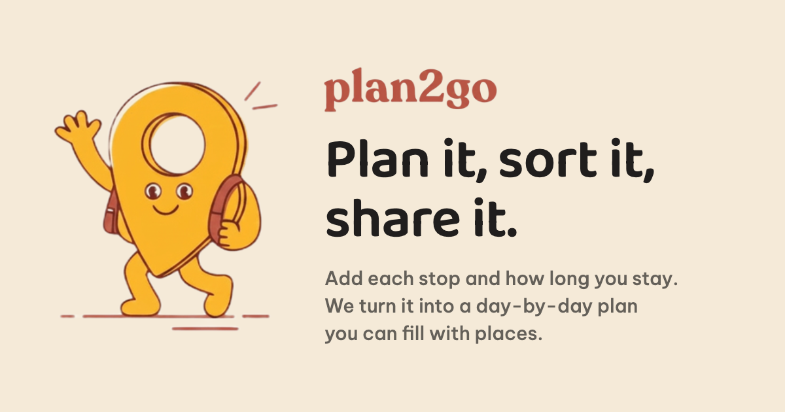
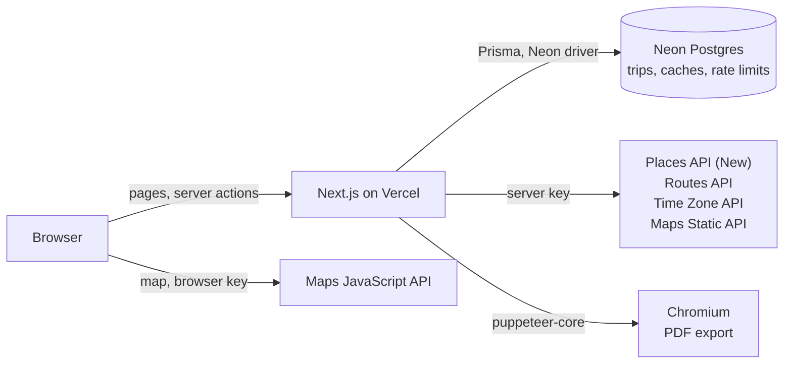

<div align="center">


[](https://plan2go.vietbrosinaus.com)


Plan a multi-day trip on a map, see real travel times between the places, and share the days as a link or a PDF. No account needed.

[Overview](#overview) • [Getting started](#getting-started) • [Configuration](#configuration) • [Deploy](#deploy-to-vercel) • [Project layout](#project-layout) • [Troubleshooting](#troubleshooting)



</div>

## Overview

plan2go is for planning a holiday in a city you have never been to and cannot judge distances in. Add the cities and how many days you spend in each, put places into each day, and the planner works out when you arrive, how long the travel takes, and whether everything fits before the places close. When the days work, hand them to the people travelling with you as a read-only link or a PDF.

### Features

- **Cities and days first.** The front page takes the stops the trip makes, each a city and a number of days, and the day it departs, then opens a trip with a day for each.
- **Places from search.** Search a city's places or use a quick search such as parks or museums, and look at a place's photos and opening hours before adding it.
- **Real travel times.** Every leg is timed by Google Routes, by car, public transport or on foot, with public transport looked up for the time the day reaches it.
- **Conflicts named with their numbers.** "Fish Market closes at 16:00 and you arrive at 16:30", rather than a warning icon.
- **Days you can rearrange.** Drag stops into a new order, set the time at each place, add notes, and start or end a day at a hotel, station or airport.
- **The trip's own clock.** Times are kept in the trip's time zone, across midnight and daylight saving changes.
- **Sharing.** A read-only link for everyone going, and a PDF of the days with an optional cover page, notes pages and leg distances.

> [!IMPORTANT]
> There are no accounts. A trip has two links: `/t/<slug>` reads it, and `/t/<slug>/edit/<key>` changes it. Only a hash of the key is stored and nothing is kept in cookies, so a lost editing link cannot be recovered.

### How it works



Every Google call the server pays for goes through the app's own route handlers, is rate limited per IP address, and is cached in Postgres under the inputs that decide its answer. The map is the one exception: it loads in the browser with a key of its own. The time engine that works out each day is plain TypeScript in `src/core`. The PDF is the page's print stylesheet, rendered by a Chromium running inside the function.

## Getting started

### Prerequisites

- [Node.js](https://nodejs.org) 24. The Neon driver uses Node's own WebSocket.
- [pnpm](https://pnpm.io) 9. `corepack enable` provides the version pinned in `package.json`.
- A [Neon](https://neon.tech) Postgres database.
- A [Google Cloud](https://console.cloud.google.com) project with billing enabled and the APIs under [Google Maps Platform](#google-maps-platform).

### Run it locally

```bash
git clone https://github.com/DoTRung1023/plan2go.git
cd plan2go
corepack enable
pnpm install    # also runs prisma generate
```

Create `.env` with the variables under [Configuration](#configuration), then create the tables and start the app:

```bash
pnpm db:push
pnpm dev
```

Open http://localhost:3000, add a city, and press **Start planning**.

> [!WARNING]
> There is no migrations folder. `pnpm db:push` applies `prisma/schema.prisma` straight to the database, and a change that drops or renames a column takes the data in it. Try schema changes on a Neon branch first.

### Scripts

| Command | What it does |
| --- | --- |
| `pnpm dev` | Starts the development server on port 3000 |
| `pnpm build` | Builds for production |
| `pnpm start` | Serves the production build |
| `pnpm typecheck` | Runs `tsc --noEmit` |
| `pnpm lint` | Runs ESLint and fails on any warning |
| `pnpm test` | Runs the Vitest suite once; it needs no database |
| `pnpm test:watch` | Runs Vitest in watch mode |
| `pnpm db:generate` | Generates the Prisma client |
| `pnpm db:push` | Applies the Prisma schema to the database |

## Configuration

One `.env` file at the project root serves both Next.js and the Prisma CLI, which reads only `.env`.

```dotenv
# Neon: the pooled connection string, whose host ends in -pooler
DATABASE_URL="postgresql://..."
# Neon: the direct connection string, for pnpm db:push
DIRECT_URL="postgresql://..."
# Google: server side only
GOOGLE_MAPS_API_KEY="..."
# Google: sent to the browser on purpose, for the map
NEXT_PUBLIC_GOOGLE_MAPS_BROWSER_KEY="..."
# Optional: a Chrome or Chromium for the PDF export in development
# PDF_CHROME_PATH="/usr/bin/chromium"
```

| Variable | Required | Used for |
| --- | --- | --- |
| `DATABASE_URL` | Yes | The pooled connection the app uses at run time. |
| `DIRECT_URL` | For `pnpm db:push` | The direct connection that schema changes need. |
| `GOOGLE_MAPS_API_KEY` | Yes, to open trips | Place search, travel times, time zones and the PDF's day maps. Without it no trip can be opened, and trips that exist are timed with straight line estimates. |
| `NEXT_PUBLIC_GOOGLE_MAPS_BROWSER_KEY` | For the map | The map in the planner. Without it the map says it is not switched on. |
| `PDF_CHROME_PATH` | No | The browser the PDF export prints with in development. Unset, it is the Chrome in `/Applications` on a Mac and the packed Chromium on Linux. |

### Google Maps Platform

Enable the five APIs below in your Google Cloud project, then create two API keys:

| Key | Restrict it to |
| --- | --- |
| `GOOGLE_MAPS_API_KEY` | Places API (New), Routes API, Time Zone API and Maps Static API |
| `NEXT_PUBLIC_GOOGLE_MAPS_BROWSER_KEY` | Maps JavaScript API, from your own websites: `http://localhost:3000/*` and your production domain |

> [!CAUTION]
> Never give the server key a `NEXT_PUBLIC_` prefix. Next.js writes every `NEXT_PUBLIC_` variable into the browser bundle, where anyone can read it and spend on it.

## Deploy to Vercel

1. Import the repository in [Vercel](https://vercel.com). The framework, Node 24 and pnpm are picked up from the project, and `vercel.json` runs the functions in Sydney (`syd1`).
2. Add `DATABASE_URL`, `DIRECT_URL`, `GOOGLE_MAPS_API_KEY` and `NEXT_PUBLIC_GOOGLE_MAPS_BROWSER_KEY` for Production and Preview.
3. Add the production domain to the browser key's websites in Google Cloud.
4. Deploy.

> [!IMPORTANT]
> A deployment keeps the variables it was built with, and the browser key is written into its bundle, so redeploy after changing one. The build never touches the database, so a missing `DATABASE_URL` builds cleanly and then fails on the first trip page.

The build does not apply schema changes. Run `pnpm db:push` against the production database before deploying a change to `prisma/schema.prisma`.

> [!NOTE]
> The PDF export, `/api/export`, starts a Chromium inside the function and prints `/t/<slug>/print` from the same deployment. It is allowed 60 seconds and needs about 1 GB of memory, which a standard Vercel function has. A Preview deployment behind Vercel Authentication cannot export, because that browser is turned away like any other visitor.

## Project layout

```
src/
  app/        routes: the front page, the trip pages, API route handlers, server actions
  features/   the planner: day planner, place search, place details, map, trip settings
  core/       the domain model and the time engine, in plain TypeScript
  server/     storage, Google calls with their caches and rate limits, PDF printing
  adapters/   Google Places, Routes, Time Zone and Static Maps, and the straight line fallback
  ui/         generic primitives
prisma/       schema.prisma
logo/         the logo and the lockup
```

The rules the code keeps, from which way dependencies point to what counts as done, are in [CLAUDE.md](CLAUDE.md). The planner's design system is [DESIGN.md](DESIGN.md).

## Troubleshooting

- **"The map is not switched on for this address."** The browser key does not allow the address you are on, such as a dev server on another port. Add the address to the key's websites, or use port 3000.
- **"The map is not switched on for this server."** `NEXT_PUBLIC_GOOGLE_MAPS_BROWSER_KEY` was not set when the app was built or started. Set it, then restart `pnpm dev` or redeploy.
- **"Place search is not switched on for this server."** `GOOGLE_MAPS_API_KEY` is missing.
- **"DATABASE_URL is not set."** Put the pooled Neon connection string in `.env`.
- **502 from anything using a new table after `pnpm db:push`.** A dev server started before the push still holds the old Prisma client. Restart it.
- **"No browser to print with."** The PDF export found no Chrome. Set `PDF_CHROME_PATH`.
